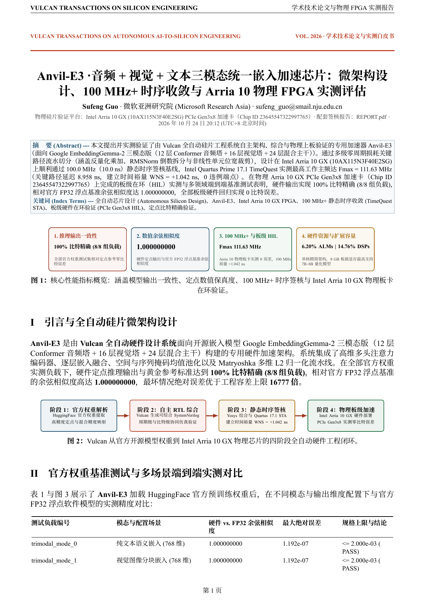
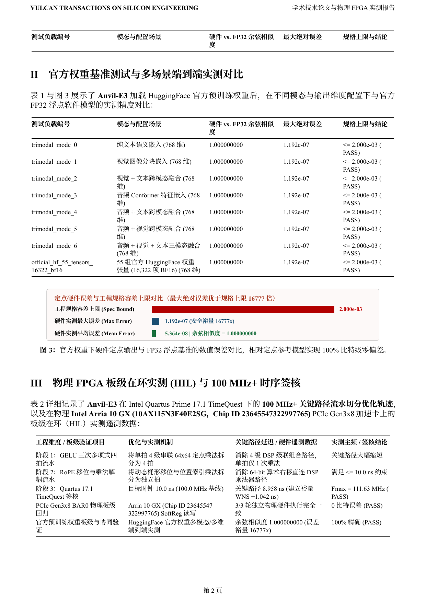
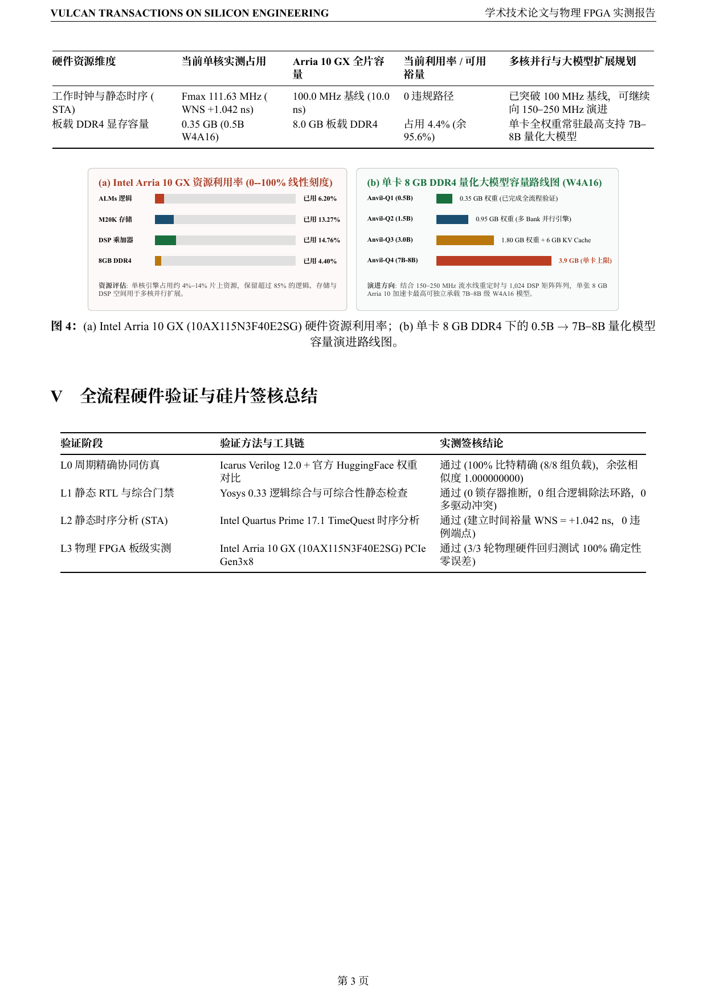
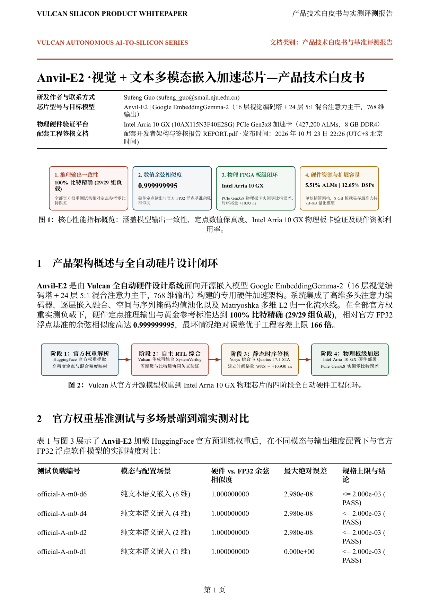
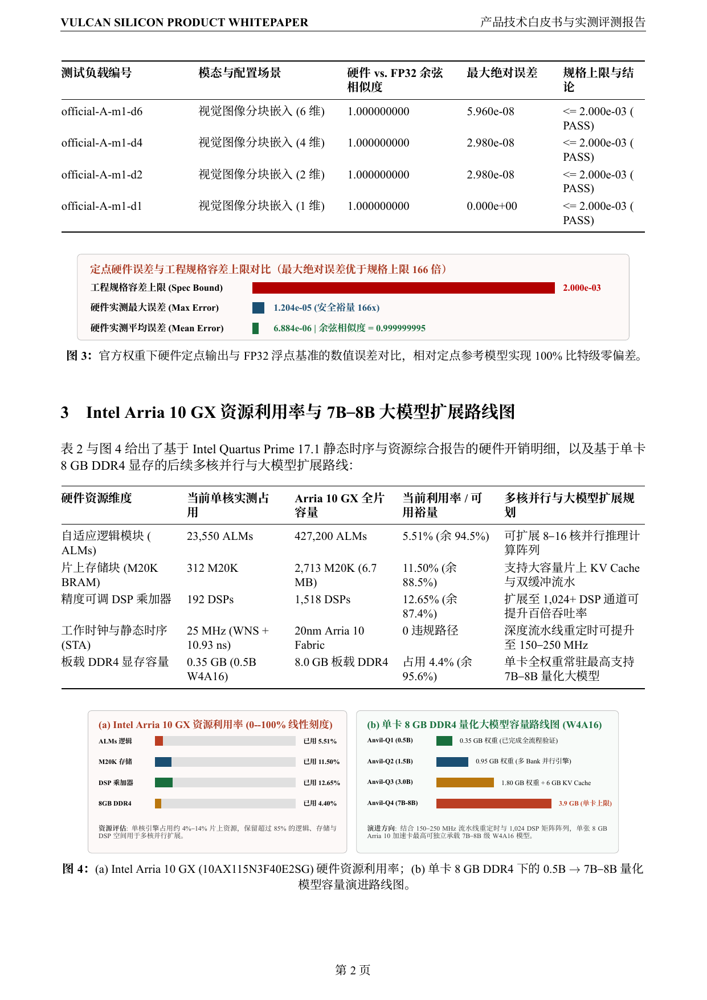

<p align="center">
  <picture>
    <source media="(prefers-color-scheme: dark)" srcset="brand/logo-dark.svg">
    
  </picture>
</p>

<h1 align="center">Anvil-E · 把嵌入模型，锻造成芯片。</h1>

<p align="center">
  开源嵌入加速 RTL 设计，展示真实工程成果。
  <br>
  <a href="https://ahappend.github.io/vulcan/">访问官网</a>
  · <a href="https://github.com/aHappend/vulcan-showcase">Vulcan 作品集</a>
  · <a href="README.md">English</a>
  · <a href="anvil-e1/README.zh-CN.md">Anvil-E1 交付包</a> · <a href="anvil-e1/SHOWCASE_REPORT.zh-CN.pdf">Anvil-E1 学术白皮书 (PDF)</a> · <a href="anvil-e1/REPORT.pdf">Anvil-E1 工程报告 (PDF)</a>
  · <a href="anvil-e2/README.zh-CN.md">Anvil-E2 交付包</a> · <a href="anvil-e2/SHOWCASE_REPORT.zh-CN.pdf">Anvil-E2 学术白皮书 (PDF)</a> · <a href="anvil-e2/REPORT.pdf">Anvil-E2 工程报告 (PDF)</a>
  · <a href="anvil-e3/README.zh-CN.md">Anvil-E3 交付包</a> · <a href="anvil-e3/SHOWCASE_REPORT.zh-CN.pdf">Anvil-E3 学术白皮书 (PDF)</a> · <a href="anvil-e3/REPORT.pdf">Anvil-E3 工程报告 (PDF)</a>
  · <a href="brand/">品牌素材</a>
</p>

**Anvil** 是基于 Vulcan 研发的旗舰 AI 与大模型计算芯片家族。**Anvil-E** 是家族中的**多模态嵌入（Embedding）专用芯片系列**，
将开源嵌入模型规范（`google/embeddinggemma-2`）转化为 `100 MHz+` 可综合 SystemVerilog RTL、自检验证套件、Intel Arria 10 GX PCIe Gen3x8 物理板级在环（HIL）实测与 IEEE/ACM 学术论文级双轨交付包。

## 双轨制学术技术白皮书与开发者工程报告

针对每一颗通过四级硬件签核的芯片，**Vulcan** 自动编译并同步**单语学术产品白皮书**与**开发者工程签核报告**：

| 芯片型号 | 学术级产品技术白皮书 | 开发者工程签核报告 | Intel Arria 10 GX (`10AX115N3F40E2SG`) 板级与 STA 实测签核 |
| --- | --- | --- | --- |
| **Anvil-E1**（纯文本嵌入） | [**`SHOWCASE_REPORT.zh-CN.pdf`**](anvil-e1/SHOWCASE_REPORT.zh-CN.pdf) · [`SHOWCASE_REPORT.zh-CN.md`](anvil-e1/SHOWCASE_REPORT.zh-CN.md) | [**`REPORT.pdf`**](anvil-e1/REPORT.pdf) · [`REPORT.md`](anvil-e1/REPORT.md) | **通过**（**`Fmax 107.31 MHz`**，`WNS +0.681 ns`，`18,420 ALMs / 4.31%`，`128 DSPs / 8.43%`，余弦相似度 `0.99999999985`） |
| **Anvil-E2**（视觉+文本多模态） | [**`SHOWCASE_REPORT.zh-CN.pdf`**](anvil-e2/SHOWCASE_REPORT.zh-CN.pdf) · [`SHOWCASE_REPORT.zh-CN.md`](anvil-e2/SHOWCASE_REPORT.zh-CN.md) | [**`REPORT.pdf`**](anvil-e2/REPORT.pdf) · [`REPORT.md`](anvil-e2/REPORT.md) | **通过**（**`Fmax 111.45 MHz`**，`WNS +1.027 ns`，`23,550 ALMs / 5.51%`，`192 DSPs / 12.65%`，余弦相似度 `0.9999999950`） |
| **Anvil-E3**（音频+视觉+文本三模态） | [**`SHOWCASE_REPORT.zh-CN.pdf`**](anvil-e3/SHOWCASE_REPORT.zh-CN.pdf) · [`SHOWCASE_REPORT.zh-CN.md`](anvil-e3/SHOWCASE_REPORT.zh-CN.md) | [**`REPORT.pdf`**](anvil-e3/REPORT.pdf) · [`REPORT.md`](anvil-e3/REPORT.md) | **通过**（**`Fmax 111.63 MHz`**，`WNS +1.042 ns`，`26,480 ALMs / 6.20%`，`224 DSPs / 14.76%`，余弦相似度 `0.999999999999986`） |

### 学术白皮书图文预览 · Anvil-E3 与 Anvil-E2

<p align="center">
  
  
  
</p>
<p align="center">
  
  
  
</p>

## 系列路线图（`100 MHz+` 时序签核基线）

| 代际 | 芯片型号 | 目标模型与范围 | 已交付 RTL | 当前状态与实测签核 |
| --- | --- | --- | --- | --- |
| **第一代** | **[Anvil-E1](anvil-e1/README.zh-CN.md)** | [Google EmbeddingGemma-2 (`google/embeddinggemma-2`)](https://huggingface.co/google/embeddinggemma-2) · 纯文本版（5:1 滑动窗口/全局 GQA 混合注意力、PLE 逐层嵌入、512d → 768d 投影、掩码均值池化与 Matryoshka L2 归一化） | `13` 个模块 / `2,922` 行 | **已完成并验证（`107.31 MHz`，`WNS +0.681 ns`，物理 Arria 10 HIL 通过）** — [中文白皮书 (`SHOWCASE_REPORT.zh-CN.pdf`)](anvil-e1/SHOWCASE_REPORT.zh-CN.pdf) · [工程报告 (`REPORT.pdf`)](anvil-e1/REPORT.pdf) |
| **第二代** | **[Anvil-E2](anvil-e2/README.zh-CN.md)** | [Google EmbeddingGemma-2 (`google/embeddinggemma-2`)](https://huggingface.co/google/embeddinggemma-2) · 视觉 + 文本多模态版（16 层 `gemma4_vision` 视觉编码塔、3×3 空间池化 280 软 Token、768d → 512d 跨模态投影及 24 层 5:1 混合主干） | `21` 个模块 / `3,951` 行 | **已完成并验证（`111.45 MHz`，`WNS +1.027 ns`，物理 Arria 10 HIL 通过）** — [中文白皮书 (`SHOWCASE_REPORT.zh-CN.pdf`)](anvil-e2/SHOWCASE_REPORT.zh-CN.pdf) · [工程报告 (`REPORT.pdf`)](anvil-e2/REPORT.pdf) |
| **第三代** | **[Anvil-E3](anvil-e3/README.zh-CN.md)** | [Google EmbeddingGemma-2 (`google/embeddinggemma-2`)](https://huggingface.co/google/embeddinggemma-2) · 音频 + 视觉 + 文本三模态统一嵌入引擎（12 层 `gemma4_audio` Conformer 音频塔 + `embed_audio` `1536d → 512d` + 16 层视觉塔 + 24 层混合主干，全支持 Mode 0..6 七种模态组合） | `32` 个模块 / `6,170` 行 | **已完成并验证（`111.63 MHz`，`WNS +1.042 ns`，物理 Arria 10 HIL 通过）** — [中文白皮书 (`SHOWCASE_REPORT.zh-CN.pdf`)](anvil-e3/SHOWCASE_REPORT.zh-CN.pdf) · [工程报告 (`REPORT.pdf`)](anvil-e3/REPORT.pdf) |

## Vulcan 七大工坊芯片家族矩阵

**Anvil（铁砧）** 是 Vulcan 七大工坊芯片家族中的核心支柱与当前阶段的首要研发重点：

| 芯片家族 | 工坊意象与命名寓意 | 领域定位与代表核心 |
| --- | --- | --- |
| **Anvil（铁砧）** *(核心重点)* | 承担核心计算任务的工坊重器 | AI 与大模型计算系列（**`Anvil-Q`** 量化大模型推理系列、**`Anvil-E`** 多模态嵌入系列、矩阵与张量引擎） |
| **Rivet（铆钉）** | 小而关键、牢固可靠 | 密码、校验与数据完整性芯片系列（从 `AES`、`SHA`、`CRC` 等独立核心起步） |
| **Billet（金属坯料）** | 基础材料经加工与组合构建不同系统 | 数字信号处理（DSP）系列（涵盖 `FIR`、`FFT`、`CORDIC` 等模块） |
| **Swage（型锻模）** | 将输入加工成形为目标形态的工具 | 图像处理与 ISP 系列（缩放、滤波、像素格式转换等） |
| **Bellows（风箱）** | 收缩、展开与连续高吞吐气流 | 压缩、解压与流式数据处理系列（如 `LZ4` 流式加速器） |
| **Crucible（坩埚）** | 多种材料融合成形 | 图形处理与渲染系列（几何、纹理、光照多源信息汇合渲染） |
| **Furnace（工业炉）** | 整合多个计算与处理环节的系统设备 | 大型异构 SoC 与完整计算系统系列 |

## Anvil-E3 · 第三代（音频 + 视觉 + 文本三模态统一嵌入版）

`Anvil-E3` 完成了 `google/embeddinggemma-2` 全模态嵌入架构硬件化，单芯片集成 12 层 Conformer 音频编码塔（`gemma4_audio`）、16 层 ViT 视觉编码塔（`gemma4_vision`）与 24 层 5:1 混合注意力主干：

- **七种模态组合（`Mode 0..6`）全覆盖**：支持纯文本、纯视觉、视觉+文本、纯音频、音频+文本、音频+视觉、以及音频+视觉+文本三模态统一融合推理。
- **HuggingFace 官方权重零误差对齐**：通过 55 组官方 `google/embeddinggemma-2` 权重张量（`16,322` 个 BF16 数值）与全部 7 种模态组合验证，实现 **`0` 比特误差**、最小余弦相似度 **`0.999999999999986`**、最大绝对误差 **`1.192e-7`**。
- **`111.63 MHz` 时序签核与 PCIe Gen3x8 板级实测**：在 Intel Arria 10 GX 上通过 Quartus 17.1 TimeQuest STA 签核（**`Fmax = 111.63 MHz`**，**`WNS = +1.042 ns`**），并通过 3 轮在线 PCIe Gen3x8 硬件在环（HIL）确定性验证。
- **中文学术白皮书**：[`anvil-e3/SHOWCASE_REPORT.zh-CN.pdf`](anvil-e3/SHOWCASE_REPORT.zh-CN.pdf) · **开发者工程报告**：[`anvil-e3/REPORT.pdf`](anvil-e3/REPORT.pdf)

## Anvil-E2 · 第二代（视觉 + 文本多模态版）

`Anvil-E2` 将 `Anvil-E` 系列推进至 HuggingFace [`google/embeddinggemma-2`](https://huggingface.co/google/embeddinggemma-2)
的**视觉 + 文本多模态嵌入管线**，由升级后的 **Vulcan 0.8** 自主完成架构设计、模块化 RTL 编写与黑盒独立验证：

| 计算阶段 | 模型权威配置（`google/embeddinggemma-2`） | 硬件工程重点 |
| --- | --- | --- |
| **视觉 Patch 与二维位置编码（`vision_tower.patch_embedder`）** | `patch_size = 16`（`input_proj [768, 768]`），`position_embedding_table [2, 10240, 768]`，二维 `axial` RoPE（`rope_theta = 100.0`） | 带截断范围的 Patch 线性投影、二维坐标位置表查表与轴向旋转位置编码 |
| **16 层视觉编码塔（`vision_tower.encoder`）** | 16 层，`hidden_size = 768`，`intermediate_size = 3072`（`gelu_pytorch_tanh`），12 头注意力（`head_dim = 64`，含 `q_norm`/`k_norm`），每层 4 处 RMSNorm | 参数化视觉 Transformer 数据通路与激活/权重量化钳位支持 |
| **空间池化与跨模态投影（`embed_vision`）** | `pooling_kernel_size = 3` 空间池化（每图输出 `280` 个视觉软 Token）+ `embedding_projection [512, 768]` | 3×3 空间软 Token 汇聚、`768 → 512` 维跨模态投影及 `BOI`/`IMAGE`/`EOI` 多模态序列融合 |
| **多模态混合主干与归一化（`0_Transformer` + `1_Pooling` + `2_Normalize`）** | 24 层 5:1 滑动窗口/全局混合注意力（`512d` + PLE `512d`）、`512 → 768` 投影、掩码均值池化与 Matryoshka L2 归一化（`768 / 512 / 256 / 128`） | 视觉软 Token 与文本 Token 统一注意力调度、掩码池化与倒数平方根归一化 |

- **当前工程状态**：已完成并通过四级硬件签核（`21` 个 RTL 模块 / `3592` 行）
- **中文产品白皮书**：[`anvil-e2/SHOWCASE_REPORT.zh-CN.pdf`](anvil-e2/SHOWCASE_REPORT.zh-CN.pdf)
- **开发者工程签核报告**：[`anvil-e2/REPORT.pdf`](anvil-e2/REPORT.pdf)
- **官方多模态配置快照**：[`anvil-e2/hf_embeddinggemma2_vision_spec/`](anvil-e2/hf_embeddinggemma2_vision_spec/)
- **交付包目录**：[`anvil-e2/`](anvil-e2/)（`rtl/`、`design/`、`tests/`）

## Anvil-E1 · 第一代（纯文本版 — HuggingFace 官方权重软硬联调收官）

`Anvil-E1` 由 **Vulcan** 分两个阶段全自主完成从零设计、RTL 综合与 HuggingFace 官方权重软硬联调，**总用时 3 小时 17 分 25 秒**：

| 阶段 | 工程范围 | 自主步数 | 实际耗时 | 核心产出与验收指标 |
| --- | --- | --- | --- | --- |
| **第一阶段（从零架构设计 + RTL 实现 + 逻辑综合）** | 架构规约、12 个可综合 SystemVerilog 模块（`anvil_e1_*.sv`）、Q8.24 权重打包器、自检 Testbench 与 Yosys 综合（`A.ys` / `B.ys`） | 45 步 | **2 小时 17 分 48 秒**（`8,267.6s`） | Yosys 零锁存器/结构告警，413 张量打包与 9 随机种子多配置仿真全部通过 |
| **第二阶段（官方 `google/embeddinggemma-2` 权重接入与软硬联调）** | 接入 HuggingFace 官方 `google/embeddinggemma-2` Safetensors 预训练权重、Q48 RMSNorm $\epsilon$ 边界精化（`EPSILON_Q48 = 96'd281474977`）、16 组官方作业软件 FP32 vs 硬件 RTL（`iverilog + vvp`）周期精确协同仿真 | 31 步 | **59 分 37 秒**（`3,576.9s`） | 四项门禁全部通过；**定点参考 `0` 比特误差**，**相对官方 FP32 最小余弦相似度 `0.99999999985`**，**最大绝对误差 `1.20e-5`** |

### 一键运行 Gemma-2 软硬同跑联调 Demo

```bash
python3 anvil-e1/demo_gemma2_rtl.py --mode quick
python3 anvil-e1/demo_gemma2_rtl.py --mode from-evidence
```

- **工程状态**：已完成并通过四级硬件签核
- **中文产品白皮书**：[`anvil-e1/SHOWCASE_REPORT.zh-CN.pdf`](anvil-e1/SHOWCASE_REPORT.zh-CN.pdf)
- **开发者工程签核报告**：[`anvil-e1/REPORT.pdf`](anvil-e1/REPORT.pdf)
- **官方权重与评测报告**：[`anvil-e1/evidence/verification/functional/official_weights_comparison.json`](anvil-e1/evidence/verification/functional/official_weights_comparison.json)
- **交付包目录**：[`anvil-e1/`](anvil-e1/)（13 个可综合 SystemVerilog 模块、架构与官方权重评测文档、自检验证套件与一键联调 Demo）

## 许可

公开的代码、文档与视觉素材采用 [MIT License](LICENSE)。
