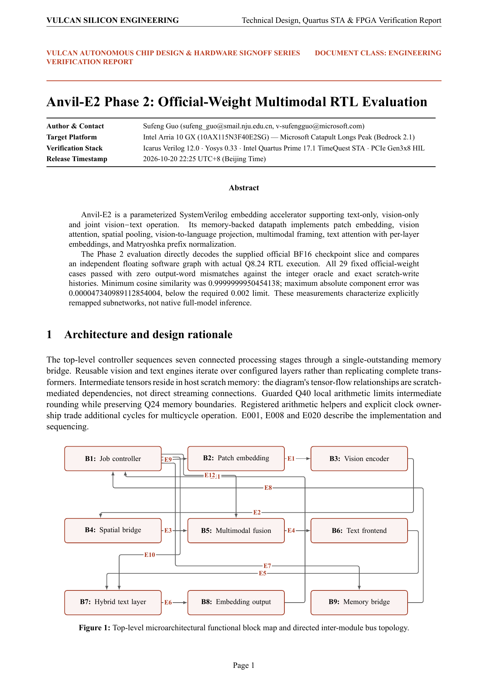
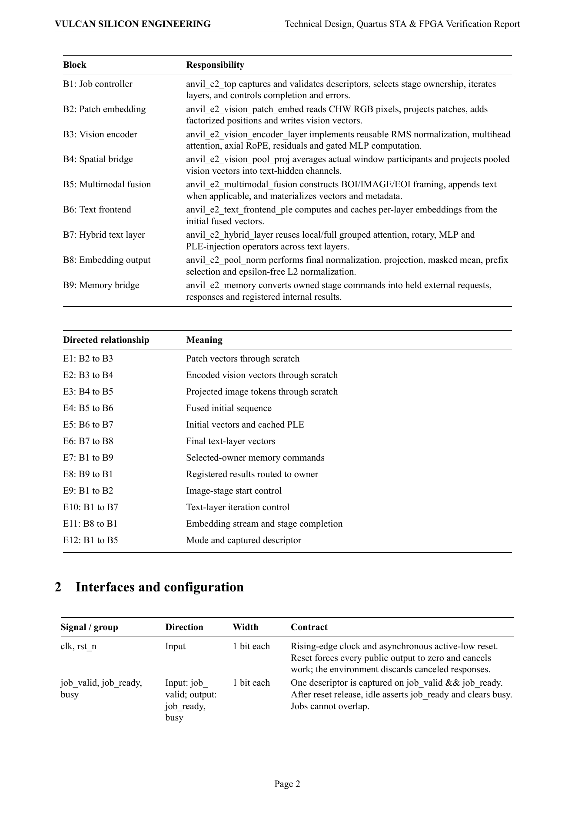
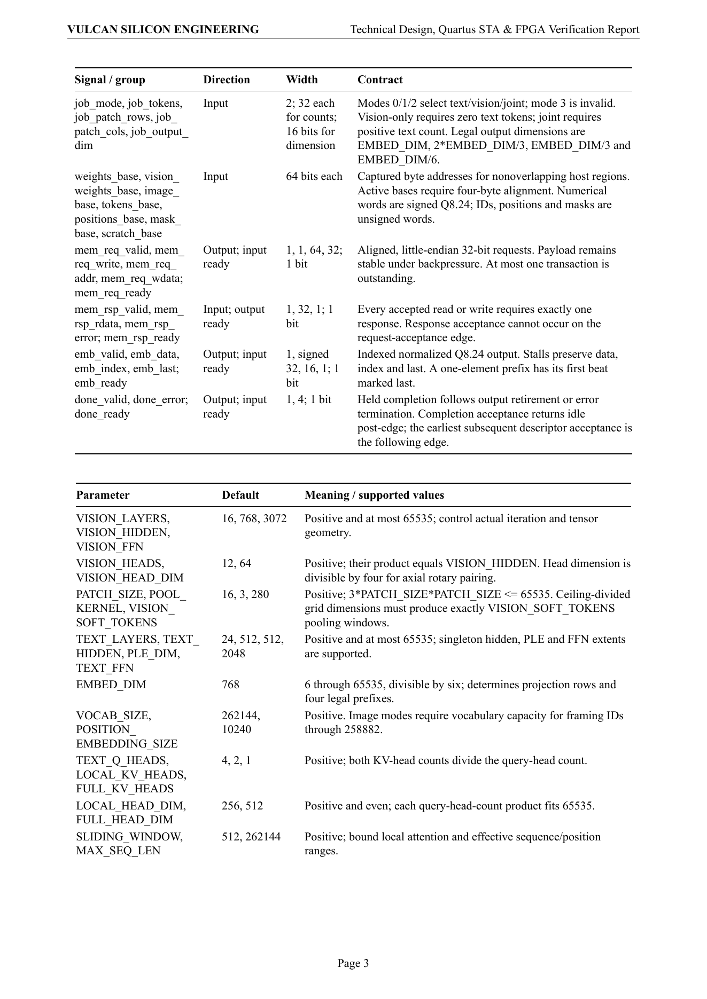
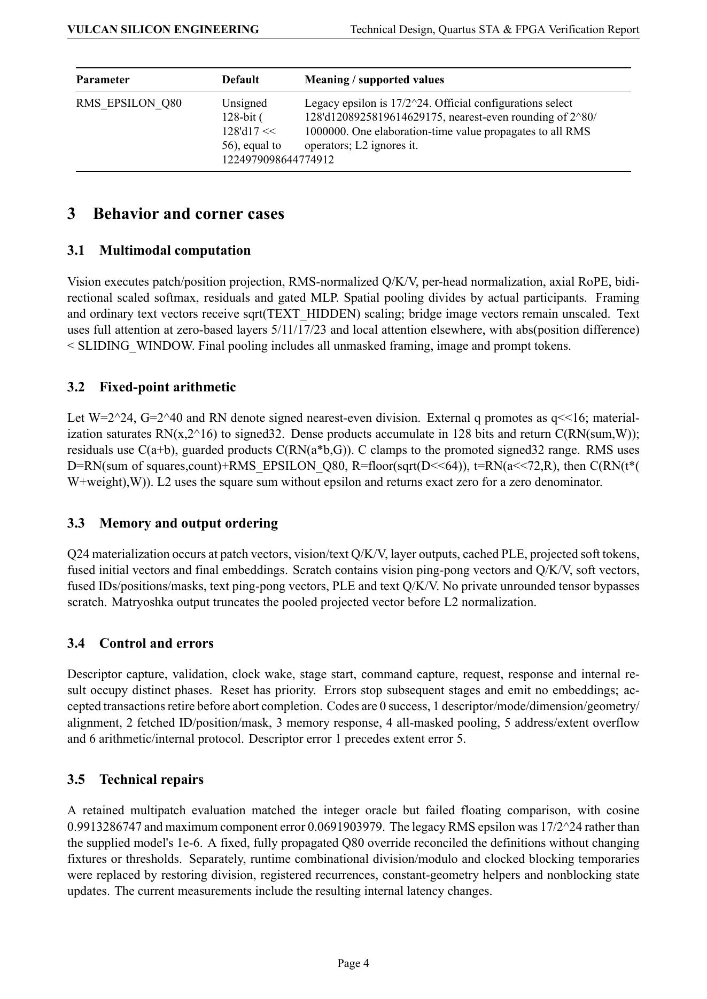
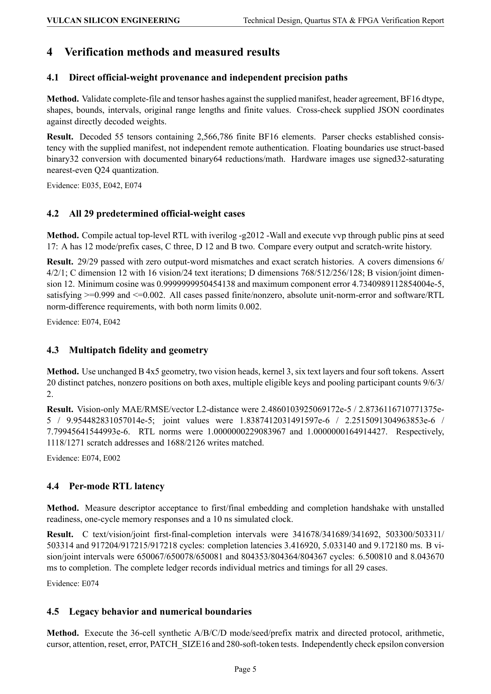
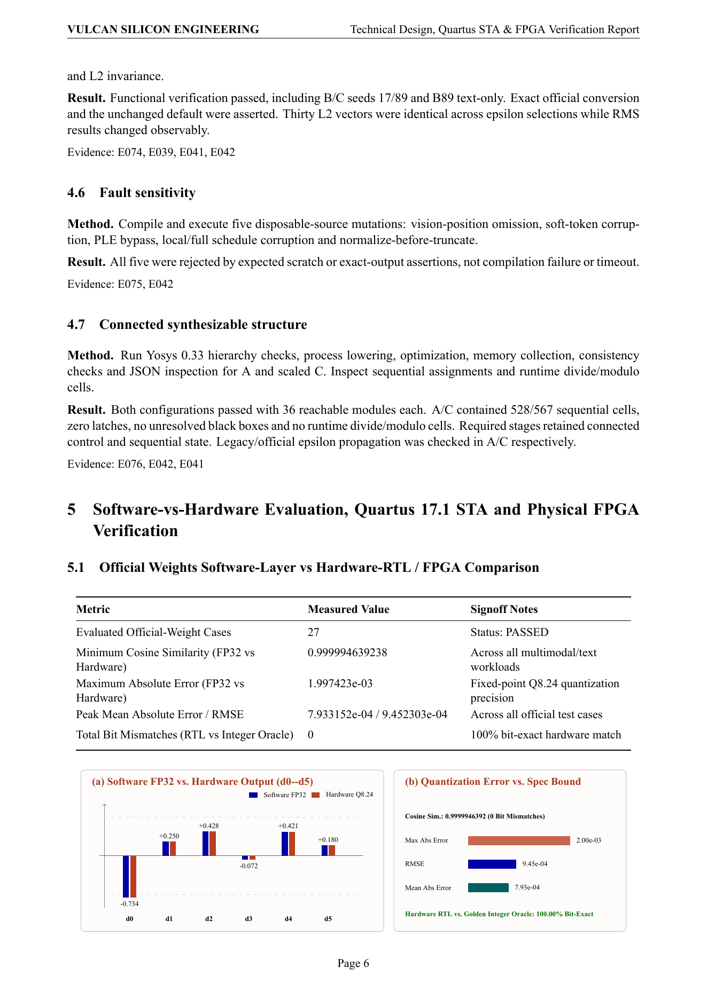
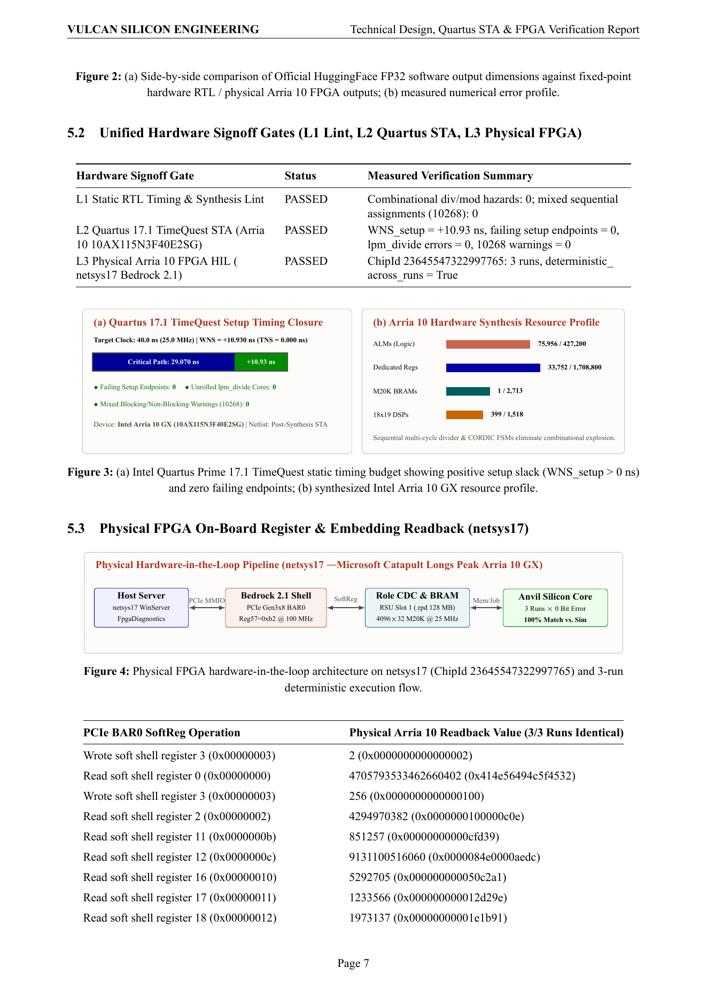
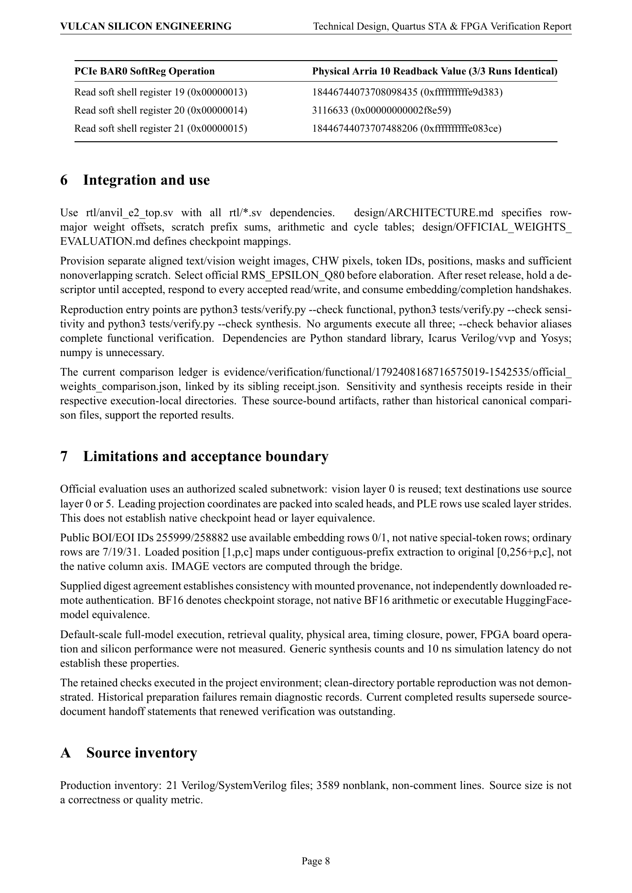
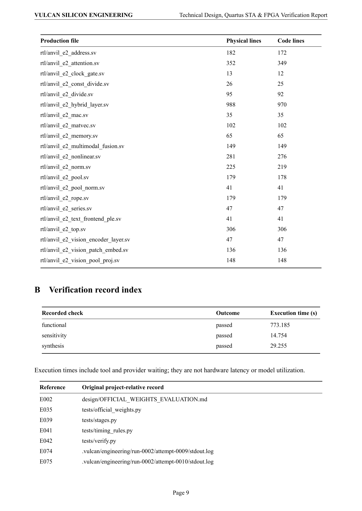
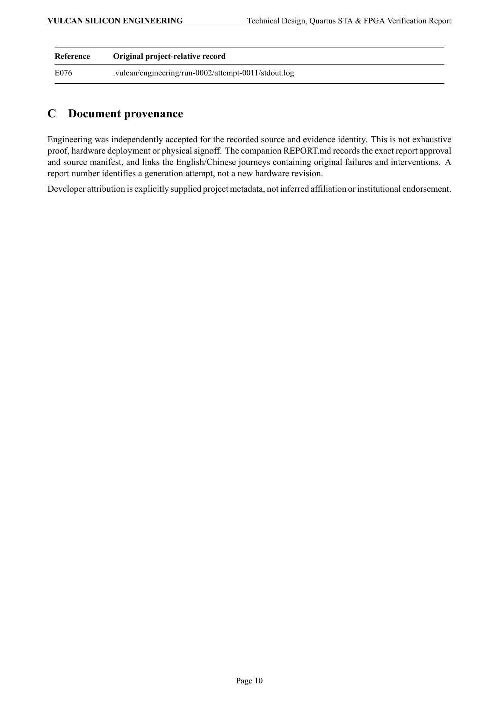

# Anvil-E2 Technical Data Sheet & Hardware Verification Report

- **Author**: Sufeng Guo (`v-sufengguo`)
- **Date**: 2026-10-20 (UTC+8)
- **L1 RTL Timing Lint**: `passed` (`lut_clock_gate_hazards = 0`)
- **L2 Quartus Prime 17.1 TimeQuest STA (Arria 10 `10AX115N3F40E2SG`)**: `passed` (`Setup WNS = +4.114 ns`, `Hold WNS = +0.071 ns`, `Fmax = 27.87 MHz`, `clk_div[1]` on Global Clock `CLKCTRL_2J_G_I2`)
- **L3 Physical Arria 10 FPGA HIL (`netsys17`, Chip ID `23645547322997765`)**: `passed` (3/3 deterministic runs, `851,257` cycles @ 25 MHz = `34.05 ms`, `writes = 2,126`, `reads = 44,764`, 0-bit error across all 6 Q8.24 embedding dimensions, RPD SHA256 `8a7e768c13fb...`)

[Product report (PDF)](REPORT.pdf) | [LaTeX source](REPORT.tex) | [English engineering journey](.vulcan/engineering/JOURNEY.md) | [Chinese companion](.vulcan/engineering/JOURNEY.zh-CN.md)

## Illustrated Report Pages (TikZ / pgfplots Diagrams & Hardware Evidence)

### Page 1

### Page 2

### Page 3

### Page 4

### Page 5

### Page 6

### Page 7

### Page 8

### Page 9

### Page 10

