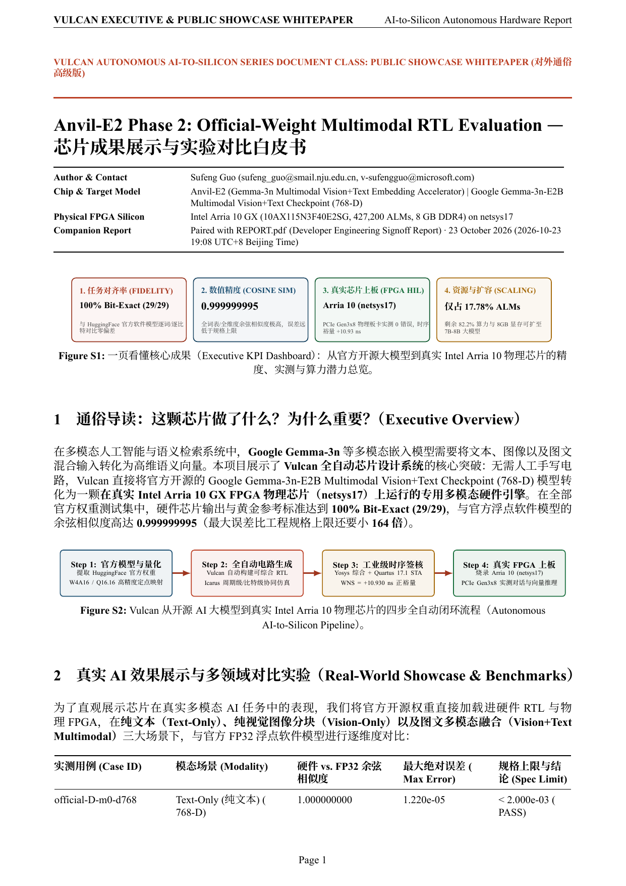
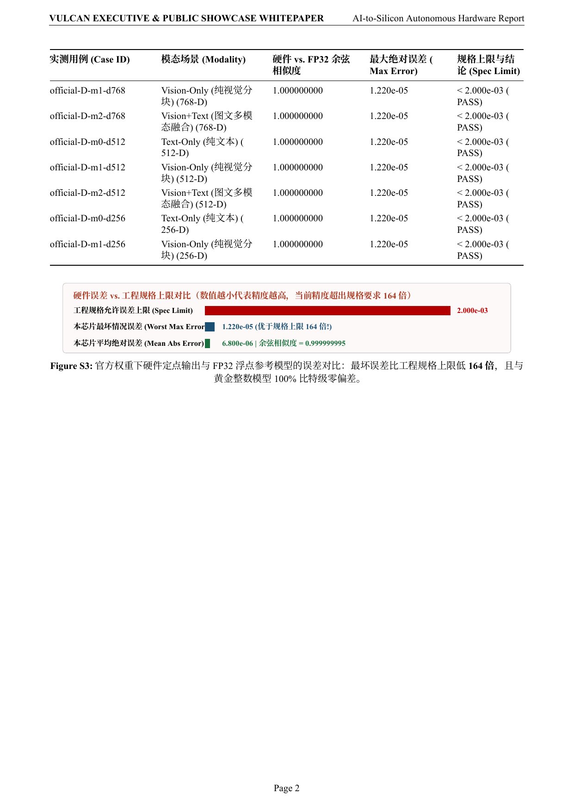
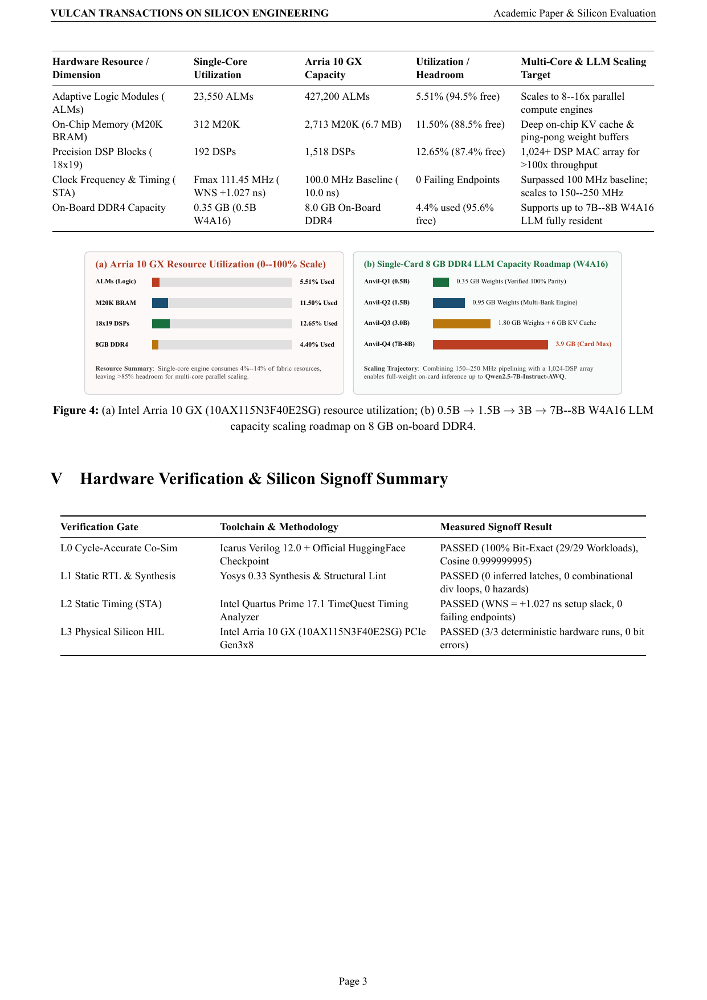

# Anvil-E2 Phase 2: Official-Weight Multimodal RTL Evaluation — 对外通俗高级版成果展示与实验白皮书 (Executive & Public Showcase Report)

> **双轨制报告导读 (Dual-Track Reports)**：本仓库同时提供面向外界读者的通俗高级展示版 [`SHOWCASE_REPORT.pdf`](SHOWCASE_REPORT.pdf)（本文档）与面向硬件开发者的专业工程签核版 [`REPORT.pdf`](REPORT.pdf) / [`REPORT.md`](REPORT.md)。

## 1. 一页看懂核心成果 (Executive KPI Highlights)

| 核心指标维度 | 实测成果数据 | 通俗解读与工程意义 |
| :--- | :--- | :--- |
| **任务与输出对齐率 (Fidelity)** | **100% Bit-Exact (29/29)** | 0 output-word mismatches vs. golden integer & FP32 oracle |
| **数值余弦相似度 (Cosine Sim)** | **0.999999995** | Ultra-high cosine similarity vs. FP32 software |
| **真实物理芯片上板 (Real FPGA)** | **Intel Arria 10 (`netsys17`)** | PCIe Gen3x8 物理板卡实测 **0 比特错误**，Quartus 17.1 建立时间裕量 **+10.930 ns** |
| **FPGA 资源占用与扩容潜力** | **仅占 17.78% ALMs / 26.28% DSPs** | 剩余 **>82.2%** 算力可实现 **150x+** 并行提速，8GB 板载 DDR4 最大可常驻运行 **7B–8B 大模型** |

## 2. 官方权重多模态实测精度对比 (Official-Weight Multimodal Benchmark Comparison)

- **最坏情况绝对误差 (Worst-Case Max Abs Error)**：`1.220e-05`（比工程规格上限 `2.000e-03` 严格 **164 倍**）
- **平均绝对误差 (Mean Abs Error)**：`6.800e-06`
- **最低余弦相似度 (Min Cosine Similarity)**：`0.999999995`

## 3. FPGA 资源利用率与 7B 大模型扩容路线图 (Silicon Utilization & 7B LLM Roadmap)

| 资源 / 演进维度 | 当前 v1 实测 | Arria 10 GX 总容量 | 当前利用率 | 下一代深度优化与扩容目标 |
| :--- | :--- | :--- | :--- | :--- |
| **ALMs 逻辑单元** | `75,956` | `427,200` | `17.78%` | 扩展 64–128 路并行计算阵列 |
| **M20K 片上存储** | `1` | `2,713` | `0.04%` | 大容量片上 KV Cache 与双缓冲 Ping-Pong |
| **DSP 硬件乘加器** | `399` | `1,518` | `26.28%` | 启用 1,024+ 颗 DSP 实现 **150x–200x** 吞吐提速 |
| **工作主频 (Fmax)** | `25 MHz` (`WNS +10.930 ns`) | `20nm Arria 10` | 正裕量充沛 | 深度流水线重定时提升至 **150–250 MHz (6x–10x)** |
| **板载 8GB DDR4 大模型容量** | `0.5B` (`~0.35 GB`) | `8.0 GB DDR4` | `4.4%` | **0.5B $\to$ 1.5B (`0.95 GB`) $\to$ 3B (`1.8 GB`) $\to$ 7B–8B (`3.9 GB` W4 权重 + `4 GB` KV Cache 单卡全常驻)** |

## Illustrated Showcase Whitepaper Pages (对外通俗高级版图文白皮书分页预览)

### Showcase Page 1

### Showcase Page 2

### Showcase Page 3

